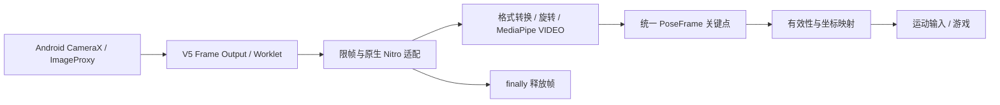

# Step 0 技术验证记录

研究日期：2026-11-02。目标设备平台：用户已确认 Android，型号待确认。

## 结论与验证边界

推荐继续验证 Expo Development Build + VisionCamera 5.2.4 + 自有 Nitro 原生 Pose 适配层。该路径有源码和官方接口依据，但**尚未编译、尚未在真机运行**。先做 Android 摄像头到原生 MediaPipe 的最小 Spike，再决定是否进入正式应用实现。

Web 路线适合独立算法对照，不能直接接收 React Native 的原生 Frame。暂不改为 WebView，也不引入旧版插件和随机依赖组合。

## 实际阅读的仓库

| 项目 / 研究快照 | 核心文件 | 可借鉴内容 | 直接复用情况 | 许可证 / 风险 |
| --- | --- | --- | --- | --- |
| [MediaPipe Web](https://github.com/google-ai-edge/mediapipe-samples-web/tree/9e907fcddbcc2d57f6560ed74bf33ed6c8338d8e) | README.md、package.json、LICENSE、src/tasks/pose-landmarker.ts、src/workers/pose-landmarker.worker.ts | 单人模型配置、VIDEO 时间戳、Worker 推理、骨骼连接、ImageBitmap 释放 | 浏览器实现不能直接迁入 RN；本项目未复制源码 | Apache-2.0；模型和图片需另核查 |
| [Squat Counter](https://github.com/dimsedra/squat-counter/tree/8a6370071f11a737430452a7e985db1f79939e65) | README.md、requirements.txt、LICENSE、src/repcounter/detect/pose_landmarker.py、features/__init__.py、count/__init__.py、tests/test_count.py | 分层、可见度门控、EMA、迟滞状态机、纯逻辑测试 | Python 实现不直接迁入 TS；不需要复用深蹲计数 | MIT；视频上传、服务端记录与本项目默认隐私目标不同 |
| [VisionCamera](https://github.com/margelo/react-native-vision-camera/tree/e3084ac562742fb3cb8c825ef81310e94f830551) | README.md、LICENSE、packages/react-native-vision-camera/package.json、src/hooks/useFrameOutput.ts、src/specs/instances/Frame.nitro.ts（后两项均在该 package 下）；docs/content/docs/index.mdx、native-frame-processor-plugins.mdx；Android HybridFrameOutput.kt；iOS HybridCameraVideoFrameOutput.swift | V5 Nitro 插件、帧线程、格式和显式释放、权限与原生重建 | 摄像头库可作为依赖候选，Pose 适配需另写 | MIT；V4 已停止维护，旧插件接口不可推定兼容 |

iOS 阅读的 VideoFrameOutput 是录像输出实现，并非推理输出的完整核查；iOS 不是当前 Spike 的验收平台。

## 版本与依赖证据

- VisionCamera 最新 release API 返回 v5.2.4，发布时间 2026-10-29；研究快照 package 同为 5.2.4。
- 其开发依赖为 RN 0.85.3、React 19.2.3、Nitro Modules 0.37.0、Nitro Image 0.15.2；这些是上游开发版本，**不代表已验证的 Expo 组合**。peer 通配符也不能作为兼容证明。
- useFrameOutput 需要 react-native-vision-camera-worklets 和 react-native-worklets。V5 通过 Nitro HybridObject 接入原生插件。
- Web 示例 package 声明 tasks-vision ^1.2.0、TypeScript ^7.0.2、Vite ^8.3.5；这里只记录上游声明，未安装也未执行。
- Squat Counter requirements 声明 mediapipe>=0.10、opencv-python>=4.9、pytest>=8.0，未据此推定精确可复现环境。

## 帧链路与线程

V5 的 Android 实现支持 YUV_420_888、RGBA_8888 和 PRIVATE。首次 Spike 应使用明确可读的 RGB 或 YUV 路径，测量转换成本，不假设 PRIVATE 硬件缓冲能直接输入 MediaPipe。官方插件接口可将 HybridFrameSpec 转为 NativeFrame 并取得 ImageProxy；仍须验证如何转换为受当前 MediaPipe SDK 支持的 MPImage。

建议首轮在专用帧线程同步 VIDEO 推理，单人、轻量模型、约 10 Hz；finally 释放 Frame，只向业务层发送关键点。异步 LIVE_STREAM 若启用，必须单独验证 MPImage、ImageProxy 和回调的所有权，不能推理未完成就释放底层缓冲。GPU 初始化及调用需保持线程约束。

Frame 的原始 timestamp 单位必须在适配时核查并转换成毫秒，不能仅凭字段名猜测。统一输出要求单调时间戳，并区分识别丢失与无新帧；旧会话结果必须丢弃。镜像、旋转与预览 cover 裁剪统一由可测试坐标变换处理。

## 两条路线比较

| 路线 | 依据 | 代价与下一步 |
| --- | --- | --- |
| 原生 MediaPipe + V5 Nitro 插件 | [官方 V5 插件文档](https://visioncamera.margelo.com/docs/native-frame-processor-plugins)、[Android Pose 指南](https://developers.google.com/edge/mediapipe/solutions/vision/pose_landmarker/android) | 需自有 Kotlin / Nitro 代码、生成绑定、SDK / 模型版本锁定、真机证明 |
| 直接 LiteRT / TFLite | 可接原生帧，但不是自动获得完整 Pose Landmarker 管线 | 需自行承担人体检测、ROI、关键点后处理和跟踪；首轮不选 |
| 浏览器 Tasks Vision | [官方 Web 指南](https://developers.google.com/edge/mediapipe/solutions/vision/pose_landmarker/web_js)；示例 Worker 以 ImageBitmap + timestampMs 调用 detectForVideo 后 close | 推理同步 API 会阻塞所在的线程；Worker 可隔离 UI，但依赖浏览器能力；WebView 权限、复制成本、手机性能未验证 |

补充核查了 [munishbp 插件 README 与 Swift 源码](https://github.com/munishbp/react-native-mediapipe-pose-plugin)：其验证环境列 VisionCamera 4.7.3，源码继承 FrameProcessorPlugin。即便 README 声称 v4+，也不能视为已适配 V5 Nitro。没有选择或复制该插件。

## 许可边界

三个指定仓库的 LICENSE 已读取。这里只借鉴分层和接口设计，未复制第三方实现，未下载模型、图片、数据集或视频。后续模型必须记录独立来源、模型卡、许可证、固定版本与 SHA-256；目前模型许可核查尚未完成，不能据示例仓库许可证推定模型可用性。

## 本地可执行验证

新增独立 TypeScript 帧门控契约：限帧、不排队、单调时间戳检查、暂停、会话重置和 finally 释放。运行 `node --test tests/*.test.ts`，无需安装依赖。测试采用合成帧句柄，只证明契约行为，不证明 Nitro / Worklet、像素转换、SDK 输入或手机性能。

## Android Spike 的完成门槛

1. 准备 Android SDK / platform-tools、匹配的 JDK，adb 能列出已授权真机。
2. 核实并固定 Expo / RN / Nitro / Worklets 组合，创建 Development Build，手机可预览、暂停和退出。
3. 用自有 Nitro 插件取得 ImageProxy，显式转换为 MPImage；锁定 SDK 和许可明确的 lite 模型。
4. 连续输出 33 个关键点；离开画面清空；验证镜像、旋转、裁剪与所有资源释放。
5. 记录设备、分辨率、真实 FPS、转换及推理耗时、5 分钟稳定性。通过后再开展正式姿态与游戏集成。

当前缺 Android SDK / adb 可用性和真机连接验证，原生 Spike 未运行。
